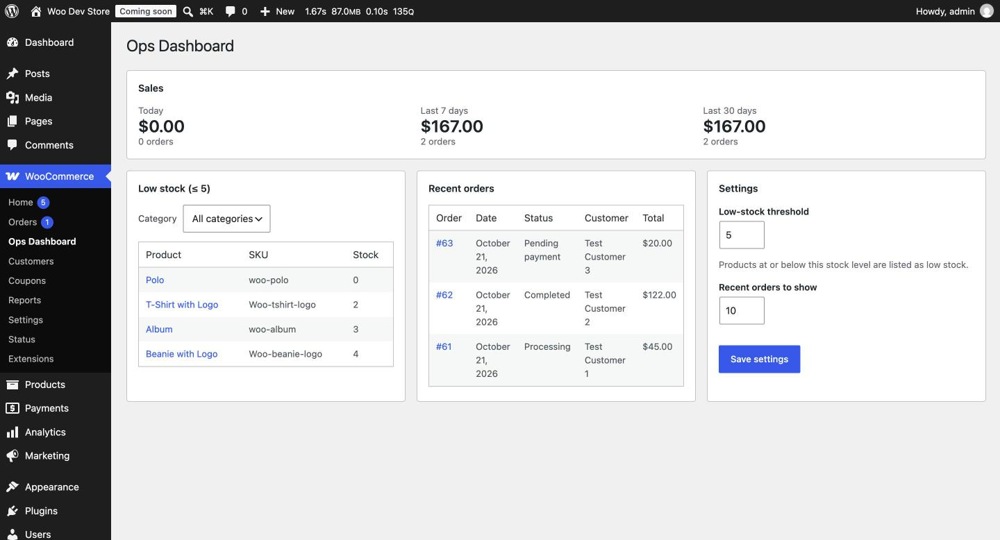

# Ops Dashboard for WooCommerce

[](https://github.com/bryanarius/ops-dashboard-for-woocommerce/actions/workflows/ci.yml)

One admin screen for store managers: low-stock products, recent orders, and sales at a glance, without clicking through several WooCommerce pages.

> **Status:** in development



## Features

- [x] Dashboard page under **WooCommerce → Ops Dashboard**
- [x] Low-stock panel with configurable threshold and links to edit each product
- [x] Recent orders panel (status, total, customer)
- [x] Sales summary: today, last 7 days, last 30 days
- [x] Settings: low-stock threshold, number of recent orders
- [x] AJAX filtering of the low-stock panel by category
- [ ] *Stretch:* stock-status filter, daily low-stock email (WP-Cron), CSV export, REST endpoint

## Built with

- PHP 8.1+, WordPress 6.5+, WooCommerce 8.2+
- WooCommerce CRUD APIs (`wc_get_products()`, `wc_get_orders()`); HPOS-compatible
- PHPUnit + Brain Monkey for unit tests
- PHPCS with WordPress Coding Standards
- GitHub Actions CI on PHP 8.1–8.3

## Security

- Every screen and handler checks the `manage_woocommerce` capability
- Nonces on all form and AJAX requests
- Input sanitized on the way in, output escaped on the way out

## Project structure

```
ops-dashboard-for-woocommerce.php   Plugin header, HPOS declaration, bootstrap
uninstall.php                       Cleanup when the plugin is deleted
includes/
  class-plugin.php                  Wires classes together
  class-settings.php                Option storage, defaults, Settings API
  data/                             Read-only queries (inventory, orders, sales)
admin/
  class-admin-page.php              Menu page, assets, rendering
  views/dashboard.php               Markup only
assets/                             Admin CSS and JS
tests/Unit/                         PHPUnit tests (no WordPress needed)
docs/decisions.md                   Design decisions and trade-offs
```

## Installation

1. Download or clone into `wp-content/plugins/ops-dashboard-for-woocommerce`.
2. Activate WooCommerce, then this plugin.
3. Go to **WooCommerce → Ops Dashboard**.

## Development

```bash
composer install
composer lint      # PHPCS (WordPress Coding Standards)
composer lint:fix  # auto-fix what PHPCS can
composer test      # PHPUnit
```

For a local store with sample data, use [LocalWP](https://localwp.com/), install WooCommerce, and import its sample products (`wp-content/plugins/woocommerce/sample-data/sample_products.csv`). Symlink this folder into the site's `wp-content/plugins/`.

## Known limitations

- **Sales totals load every paid order in the period.** Revenue is summed in PHP, so the 30-day figure can be slow on stores with thousands of orders a month. Not cached yet.
- **Variations aren't counted as low stock.** Only top-level products with stock management enabled are checked, so a low "Hoodie – Red" variation won't appear.

## License

GPL-2.0-or-later
